<div align="center">

# Ryuk

**Write your life in one line at a time. Ryuk turns it into data.**

A private, single-owner life-logging system. Text a workout, a meal or a thought from your phone; bank SMS and Apple Health sync on their own;
an LLM and a set of strict parsers turn it all into typed rows; a notebook-styled dashboard and an iPhone app show you what the days add up to.
Runs entirely on free tiers. Signs in with Face ID only.

[](https://github.com/iambharatks/ryuk/actions/workflows/ci.yml)
[](https://iambharatks.github.io/ryuk/)


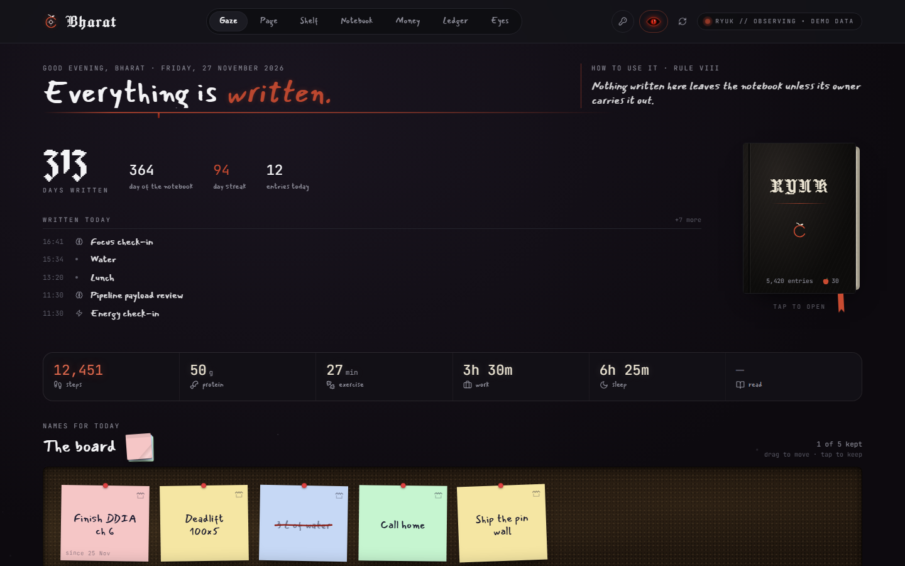

**[▶ Try the live demo](https://iambharatks.github.io/ryuk/)**: the real dashboard running on generated sample data (no backend, no sign-in).

</div>

---

## Why

Most trackers fail at the input. Ryuk takes whatever is easiest at the moment and does the structuring afterwards:

| You do this | Ryuk records |
|---|---|
| Text `bench 60x10, 65x8` to a Telegram bot between sets | `strength` rows: exercise, sets, reps, kg, rest between sets from the message times |
| Paste a whole workout or day as one note | One row per line, each at its own time, in a single LLM call |
| Write `oats with whey` on today's **Page** | `meals` row with calorie and macro estimates |
| Do nothing — your bank texts you | `finance_log` transaction, filed as food / rent / mutual fund / … |
| Do nothing — the Health Shortcut runs at night | `health_log` steps, exercise, sleep, heart rate |

Then it gives it back: streaks, a day page you can edit, a money ledger that separates spending from investing, and an "eyes" view of 30–90 day trends.

## Tour

<table>
<tr>
<td width="50%">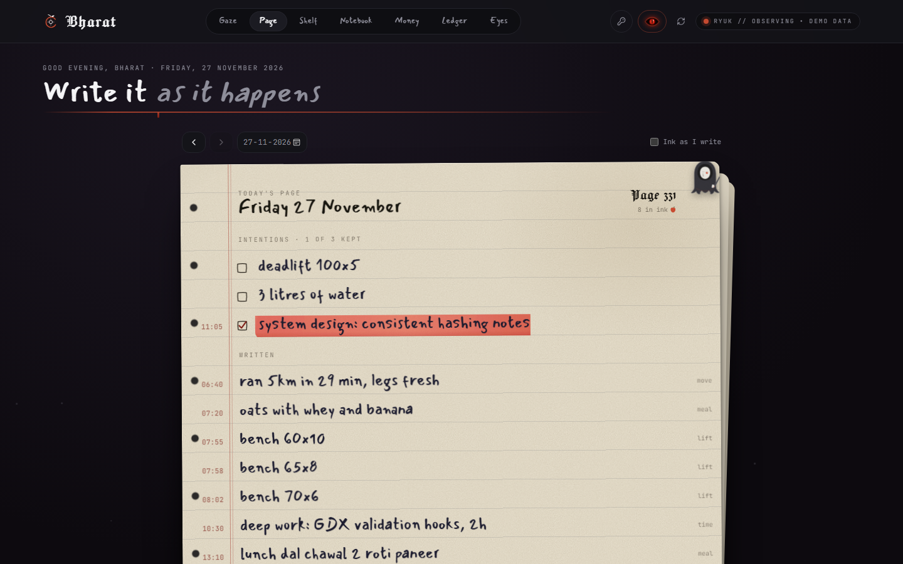<br><b>Page</b> — one ruled page per day. Lines are stamped with the time you <i>started</i> typing them, kept in pencil until inked, and parsed into rows. <code>[]</code> makes an intention; ticking it logs it.</td>
<td width="50%">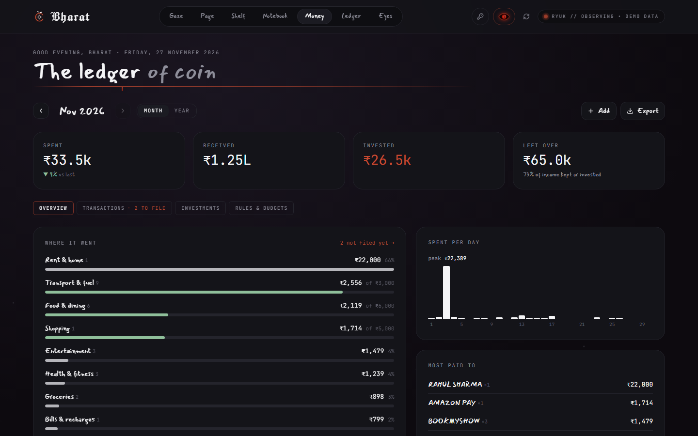<br><b>Money</b> — bank SMS become transactions, auto-filed into categories; budgets per category; month/year views; CSV/JSON export.</td>
</tr>
<tr>
<td>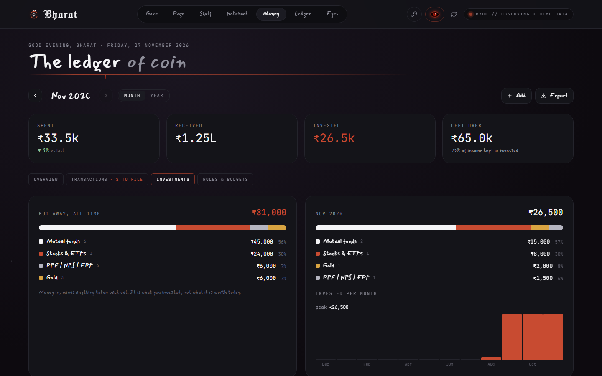<br><b>Investments</b> — mutual funds, stocks, gold, PPF/NPS, FDs and crypto recognised by name; all-time totals net of redemptions; SIPs detected automatically.</td>
<td>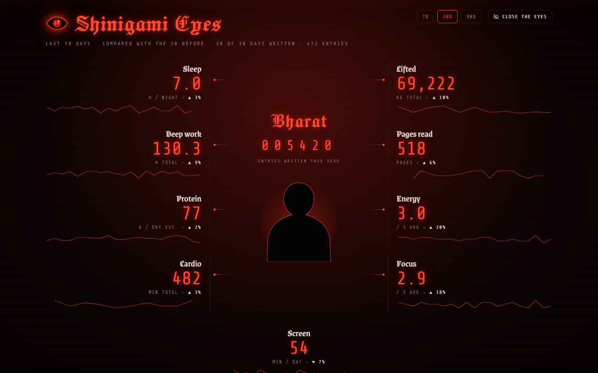<br><b>Eyes</b> — the long view: sleep, deep work, protein, volume lifted, pages read, energy and focus against the previous period.</td>
</tr>
<tr>
<td>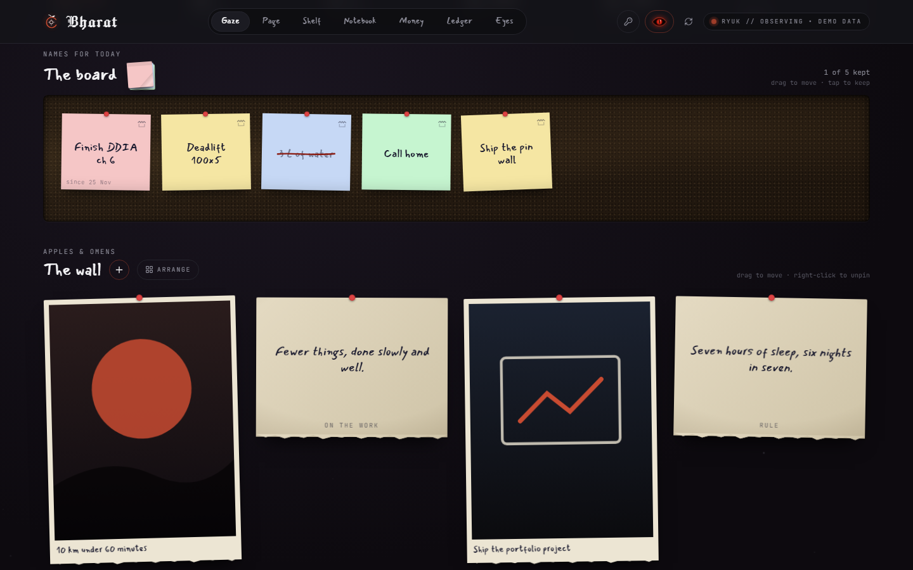<br><b>Board & wall</b> — sticky-note goals that stay until kept (drag anywhere, tear off), and a pin wall of images and quotes that packs itself into even columns.</td>
<td>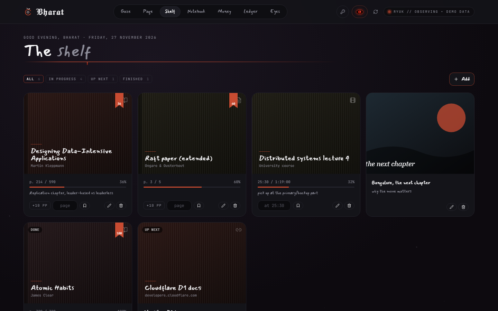<br><b>Shelf</b> — books, PDFs, videos, audio and links with a bookmark or timestamp; progress is logged as reading/watching time. Files live in R2.</td>
</tr>
<tr>
<td>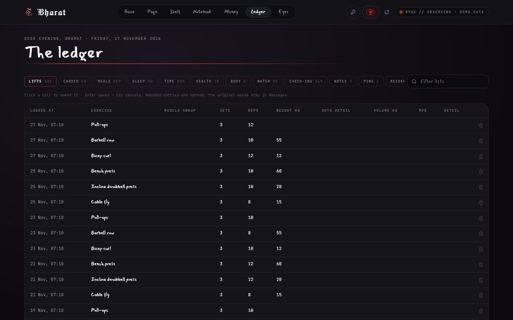<br><b>Ledger</b> — every parsed row, editable in place; the original message is kept so a correction never loses what you said.</td>
<td>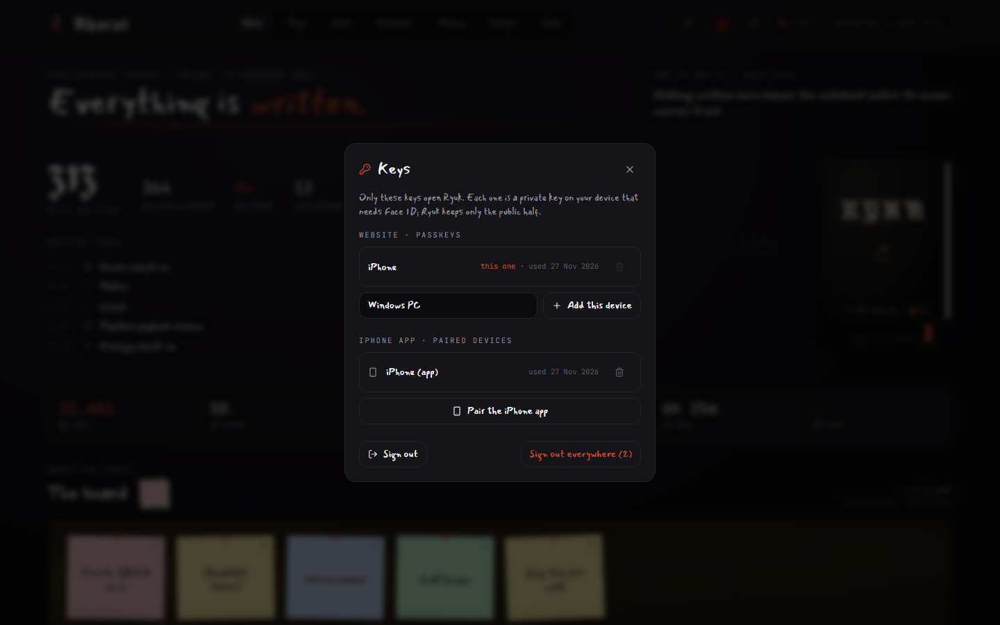<br><b>Keys</b> — the passkeys and paired iPhones that can open Ryuk; pair the app with a 6-digit code; sign out everywhere.</td>
</tr>
</table>

<p align="center">
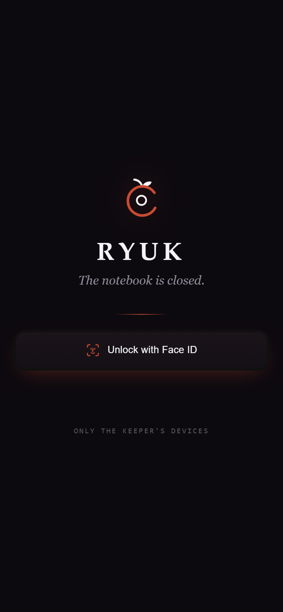
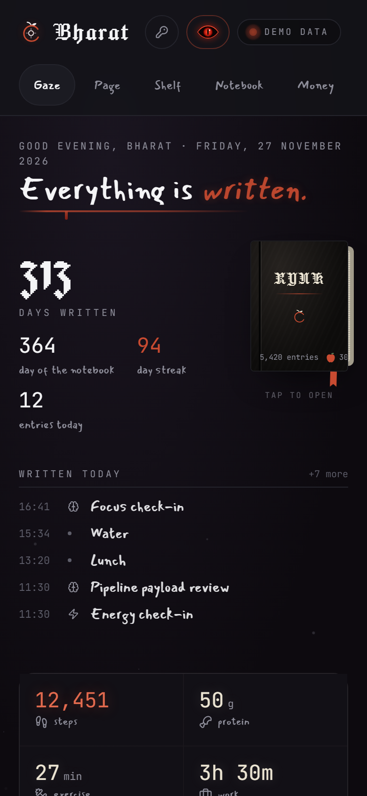
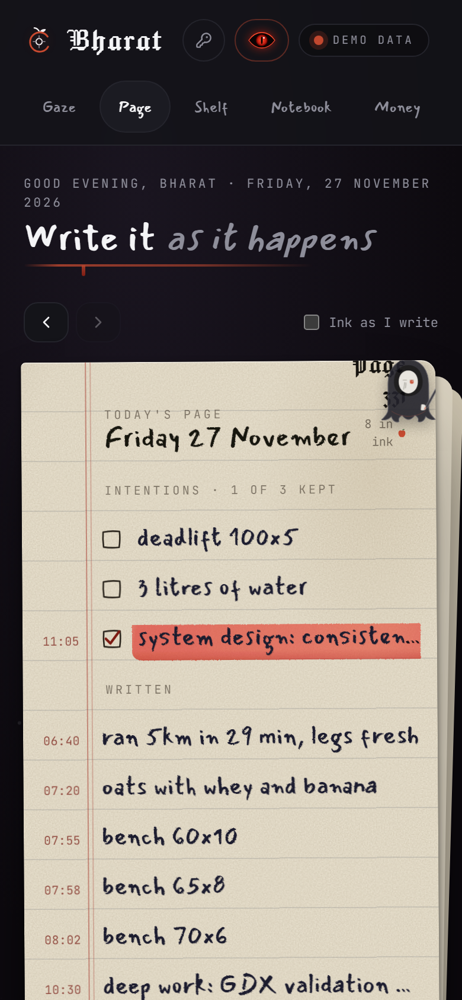
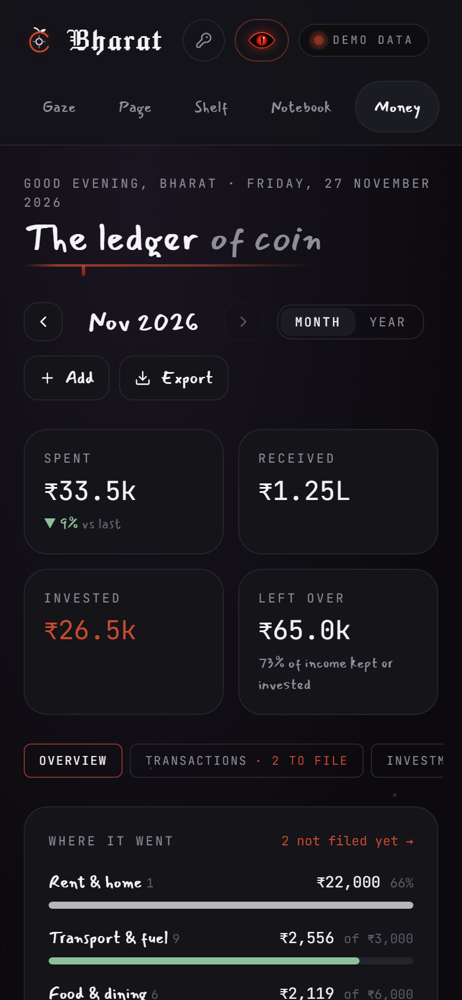
<br><sub>Phone: Face ID sign-in · Gaze · Page · Money. All screenshots use generated sample data.</sub>
</p>

## Architecture

<p align="center">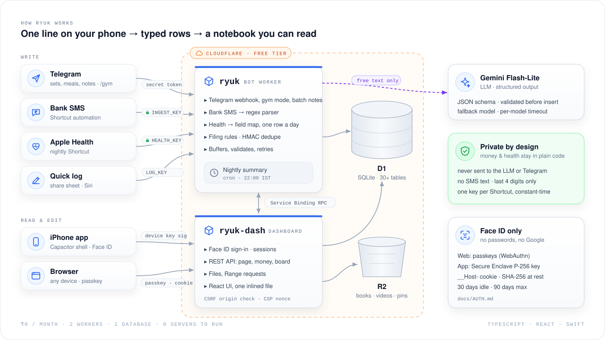</p>

Two Workers share one D1 database. The bot owns ingestion (Telegram, Shortcuts, a nightly summary); the dashboard owns sign-in, the API
and a single inlined HTML page (React, built to one file). The dashboard asks the bot to parse text through a Service Binding, so the LLM
path lives in exactly one place.

## Engineering notes

<details open>
<summary><b>Getting structured data out of an LLM, reliably</b></summary>

- Gemini is called with a **`responseSchema`**; every field is required (lite models skip optional numbers otherwise). Output is validated before
  any insert, and messages that don't parse are kept as `needs_review` for `/retry`, never dropped.
- **Primary + fallback model**, per-model timeout, fall back on 429/404/5xx/timeout.
- **Batch notes**: a pasted note is split and time-stamped in plain code (`src/batch.ts`: `18:02`, `6:40 pm`, "kal", dates), sent as *one* call,
  deduplicated per line (`batch_lines`) so re-sending mid-workout only adds new lines; rest between sets is computed from the gaps.
- **Gym mode** buffers each set with Telegram's own send time and parses the whole session on `/done`.
- The Telegram webhook is processed **before** responding: `waitUntil` work was being cut off at ~30 s.
</details>

<details>
<summary><b>Privacy by design: money and health never reach the LLM</b></summary>

- Bank SMS are parsed by **regex** (`src/finance.ts`): amount + direction + account required; OTP/PIN messages refused. An SMS that doesn't
  parse is dropped — it is never "helpfully" sent to an LLM.
- Only parsed fields are stored: **never the SMS text, only the last 4 digits** of an account. Resends are deduplicated by an HMAC keyed with
  the ingest secret.
- Transactions are filed by plain code (`src/classify.ts`): your rules first, then keyword lists; anything you filed by hand is never overwritten.
- Health data is mapped field by field (`src/health.ts`), one row per day, later syncs fill in but never blank values.
- Each Shortcut has **its own key**, compared in constant time. Telegram pings about money carry no amount or merchant.
</details>

<details>
<summary><b>Sign-in: passkeys on the web, a Secure Enclave key in the app</b></summary>

- **Website:** WebAuthn passkeys (user verification required, discoverable credentials, single-use 5-minute challenges) via `@simplewebauthn/server`.
- **iOS app:** a P-256 key generated **inside the Secure Enclave** (non-exportable, `biometryCurrentSet`), paired once with a 6-digit code shown
  on the signed-in website, then used to sign a challenge on every launch. No browser, no redirect.
  (Native app passkeys need the paid Apple Developer Program; this gives the same cryptography for free.)
- **Sessions:** 256-bit random token in a `__Host-` cookie (`Secure`, `HttpOnly`, `SameSite=Lax`); only its SHA-256 is stored; 30 days idle,
  90 days absolute; writes from another origin are refused; CSP with a per-request nonce on the login page; `frame-ancestors 'none'`.
- Full design, threat model and recovery: **[docs/AUTH.md](docs/AUTH.md)**.
</details>

<details>
<summary><b>Living inside free-tier limits</b></summary>

- D1 rejects big `UNION` views ("too many terms in compound SELECT"), so reads are per-table `DB.batch()` calls.
- R2 uploads have a storage quota and monthly Class A/B operation caps tracked in D1.
- The whole UI is one HTML file (fonts and assets inlined) served by the Worker — no static hosting, no CDN config.
- Telegram's ✍ reaction instead of a reply in gym mode keeps the chat (and the bot's message budget) quiet.
</details>

## Stack

| Layer | Choice |
|---|---|
| Compute | Cloudflare Workers (two), Service Binding RPC, Cron Trigger |
| Data | Cloudflare D1 (SQLite), R2 for files |
| LLM | Gemini Flash-Lite with JSON schema output, model fallback |
| Dashboard | React 18, Vite, Tailwind 3, lucide-react, built to a single file |
| iOS app | Capacitor 8 (Swift Package Manager), Swift: Secure Enclave, LocalAuthentication, WKWebView |
| Auth | WebAuthn (`@simplewebauthn/server`), WebCrypto ECDSA |
| Tests | Node's built-in `node:sqlite` as a fake D1, a software passkey and device key with real signatures |

## Run the demo locally

```bash
cd dash/ui
npm install
npm run dev                 # open the localhost URL: localhost always uses sample data
```

Or build the same single-file demo the live site uses and open it straight from disk:

```bash
cd dash/ui && VITE_DEMO=1 npx vite build --outDir dist-demo     # PowerShell: $env:VITE_DEMO=1; npx vite build --outDir dist-demo
# open dash/ui/dist-demo/index.html
```

## Set up your own

<details>
<summary><b>1 · Prerequisites</b></summary>

- Node 22.13+ (24 recommended) and a free **Cloudflare** account (Workers, D1; R2 only for uploads)
- A **Telegram** bot from [@BotFather](https://t.me/BotFather) and your chat id
- A **Gemini API key** from Google AI Studio (free tier)
- Optional: an iPhone (Shortcuts for bank SMS / Health) and a Mac with Xcode (the iOS app)
</details>

<details>
<summary><b>2 · Database and bot</b></summary>

```bash
git clone https://github.com/iambharatks/ryuk && cd ryuk
npm install
npx wrangler login
npx wrangler d1 create ryuk          # copy database_id into wrangler.toml AND dash/wrangler.toml
```

In `wrangler.toml` set `OWNER_CHAT_ID`, `GEMINI_MODEL` and `GEMINI_FALLBACK_MODEL`. Then:

```bash
npx wrangler d1 execute ryuk --remote --file=schema.sql      # idempotent; safe to re-run

npx wrangler secret put TELEGRAM_TOKEN
npx wrangler secret put WEBHOOK_SECRET     # letters and digits only (Telegram's rule)
npx wrangler secret put GEMINI_API_KEY
npx wrangler secret put INGEST_KEY         # bank-SMS Shortcut
npx wrangler secret put HEALTH_KEY         # Apple Health Shortcut
npx wrangler secret put LOG_KEY            # text-logging Shortcut

npm run deploy:bot
curl "https://api.telegram.org/bot<TELEGRAM_TOKEN>/setWebhook?url=https://ryuk.<you>.workers.dev/&secret_token=<WEBHOOK_SECRET>"
```

Text the bot `ran 5k in 29 min`. It replies with what it recorded.
</details>

<details>
<summary><b>3 · Dashboard and your first passkey</b></summary>

```bash
# optional, for Shelf uploads and pinned images:
npx wrangler r2 bucket create <bucket>      # then set bucket_name under [[r2_buckets]] in dash/wrangler.toml

npx wrangler secret put AUTH_SETUP_CODE --config dash/wrangler.toml    # 32+ random characters
npm run deploy:dash                                                    # builds the UI, then deploys
```

Open `https://ryuk-dash.<you>.workers.dev`, enter the setup code, and Face ID / Touch ID creates your passkey. The setup code stops working
the moment one passkey exists; add more devices from **Keys** in the header. Do not put Cloudflare Access in front of either Worker.
</details>

<details>
<summary><b>4 · iPhone Shortcuts</b></summary>

All three send `Authorization: Bearer <key>` and always get `200 {status}` for an authenticated request, so a Shortcut never errors.

| Shortcut | Endpoint | Body |
|---|---|---|
| Bank SMS (Automation → Message contains "debited", "credited", …) | `POST /ingest/finance` | `{"text": <message>}` |
| Apple Health (daily, Automation → Time of day) | `POST /ingest/health` | `{"steps": …, "exerciseMinutes": …, "sleepMinutes": …, "date": "YYYY-MM-DD"}` |
| Text log (share sheet / Siri) | `POST /ingest/log` | `{"text": "bench 3x10 60"}` |

```bash
curl -X POST https://ryuk.<you>.workers.dev/ingest/finance -H "Authorization: Bearer <INGEST_KEY>" \
  -H "content-type: application/json" -d '{"text":"Rs.250.00 debited from A/c **1234 on 27-Nov-26 at SWIGGY. UPI Ref 433012345678"}'
# → {"ok":true,"status":"recorded","category":"food",...}
```
</details>

<details>
<summary><b>5 · iOS app (optional, needs a Mac)</b></summary>

```bash
cd ios-app && npm install && npx cap sync ios && npx cap open ios
```

In Xcode pick your iPhone (the simulator has no Secure Enclave), set your Team under Signing, and Run. On the website open **Keys → Pair the
iPhone app** and type the 6-digit code into the app. From then on: open the app, Face ID, done. Dashboard changes deploy without rebuilding
the app; only `ios-app/` changes need Xcode. A free Apple ID re-signs every 7 days.
</details>

## Using it

| Where | What |
|---|---|
| Telegram | Any sentence. `/today` · `/undo` · `/retry` · `/gym [label]` → sets → `/done` (also `/status`, `/cancel`) |
| Telegram, batch | Paste many lines; `18:02 bench 60x10`, `6:40 pm squat 80x5`; optional date header (`24/11`, `yesterday`, `kal`) |
| Page | Type a line, Enter. `[]` for an intention. Tap a line to fix its words or time. ← → or swipe turns pages |
| Money | Tap a transaction to file it, mark it as an investment, or "always file this merchant like this" |
| Nightly | 22:00 IST: a summary of the day in Telegram (no money details) |

## Tests

```bash
npm run typecheck
npm test          # ingest parsers + endpoints, batch notes, dashboard API and sign-in (~250 checks)
```

The dashboard suite runs the real Worker against `node:sqlite`, with a **software passkey** and a **software Secure Enclave key** producing real
WebAuthn bytes and ECDSA signatures — so replay, wrong origin, missing user verification and foreign keys are tested end to end.

## Project layout

| Path | What |
|---|---|
| `src/` | Bot Worker: Telegram, Gemini, batch notes, gym mode, `finance.ts`, `classify.ts`, `health.ts`, `ingest.ts`, cron |
| `dash/src/` | Dashboard Worker: `auth.ts` + `login.ts` (sign-in), `coin.ts` (money), `workspace.ts` (board, wall), `extra.ts` (page, shelf, files) |
| `dash/ui/` | Dashboard UI (React). `npm run build:ui` → `dash/src/page.html` |
| `ios-app/` | Capacitor iOS app: Secure Enclave sign-in in `ios/App/App/RyukWebViewDelegate.swift` |
| `schema.sql`, `migrations/` | D1 schema (idempotent) and one-off migrations |
| `tests/` | Ingest, batch and dashboard suites; `softkey.mjs` software authenticator |
| `docs/AUTH.md` | Sign-in design, threat model, recovery |

## Privacy rules this code keeps

1. Financial and health data never go to the LLM, Telegram, logs or any third party.
2. Store the minimum: no SMS text, no full account numbers, no OTPs, PINs or passwords.
3. Secrets only through `wrangler secret put` — never in code, config or commits.
4. Every endpoint is authenticated: Telegram secret token + owner chat id, a per-source ingest key, or a dashboard session.

---

<sub>A personal project. The demo and screenshots use generated sample data and original artwork (demo builds swap in an original notebook
cover, see <code>dash/ui/vite.config.ts</code>). Fonts are from Fontsource under the SIL Open Font License.</sub>
